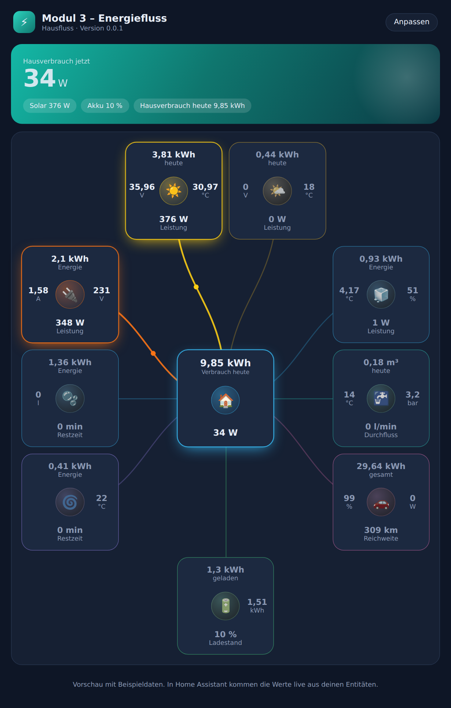
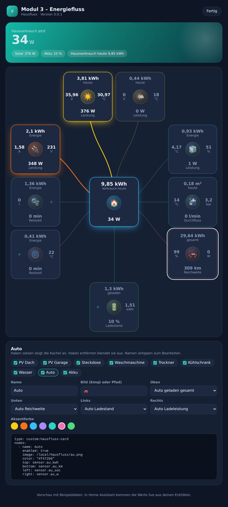
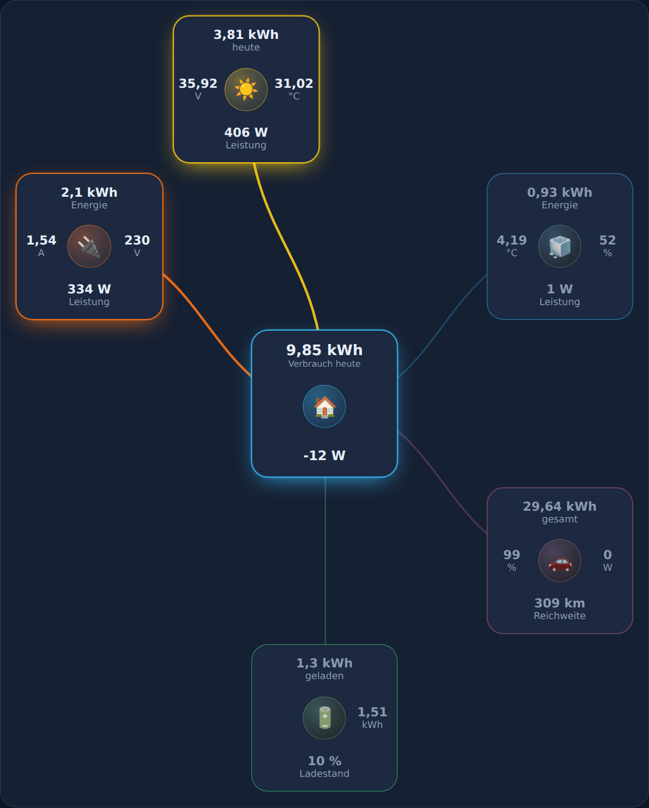
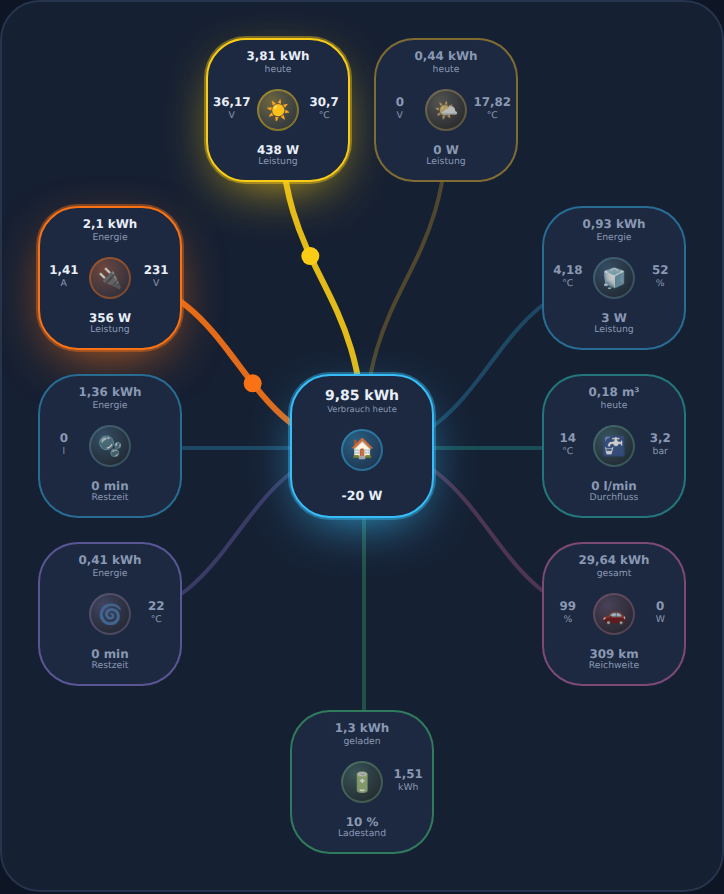

# Hausfluss – Modul 3 Energiefluss (v0.0.1)

Lovelace-Karte für Home Assistant: ein Haus-Knoten in der Mitte, bis zu 9 Kacheln drumherum.
Jede Kachel hat ein Bild in der Mitte und je eine Entität oben, unten, links und rechts.

## Vorschau


| Editor | Kacheln abgewählt | Mobil |
|---|---|---|
|  |  |  |

Die Bilder zeigen die Vorschau mit Beispieldaten.

## Installation (HACS, Kategorie Integration)
1. HACS → ⋮ → *Benutzerdefinierte Repositories* → Repository-URL eintragen, Kategorie **Integration**.
2. „Hausfluss“ installieren und Home Assistant neu starten.
3. Einstellungen → Geräte & Dienste → **Integration hinzufügen** → *Hausfluss*. Ein Klick genügt.
4. Dashboard bearbeiten → Karte hinzufügen → **Hausfluss**. Im Editor Kacheln an- oder abwählen und Entitäten wählen.

Die Karte wird von der Integration selbst ausgeliefert und geladen. Eine Dashboard-Ressource musst du nicht von Hand anlegen.
Manuell: den Ordner `custom_components/hausfluss` nach `config/custom_components/` kopieren.
Beim Veröffentlichen auf GitHub ein Release mit dem Tag `v0.0.1` anlegen und `DEIN-NAME` in der `manifest.json` ersetzen.

## YAML-Beispiel
```yaml
type: custom:hausfluss-card
title: Modul 3 – Energiefluss
hub:
  name: Haus
  image: 🏠
  top: sensor.haus_energie_heute
  bottom: sensor.haus_leistung
nodes:
  - position: top_1        # top_1, top_2, left_1-3, right_1-3, bottom
    enabled: true          # false blendet die Kachel aus
    name: PV Dach
    image: /local/hausfluss/solar.png   # Pfad, Emoji oder mdi:icon
    color: "#facc15"
    direction: in          # in = liefert, out = verbraucht
    top: sensor.pv_energie_heute
    bottom: sensor.pv_leistung
    left: sensor.pv_spannung
    right: sensor.pv_temperatur
    power: sensor.pv_leistung   # optional, steuert die Fluss-Animation
```
Tippen auf einen Wert öffnet den Verlauf der Entität.
