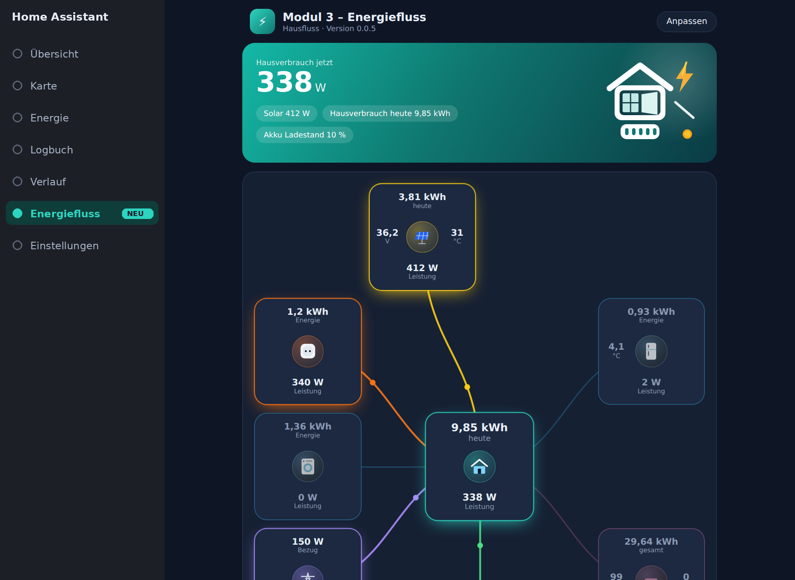
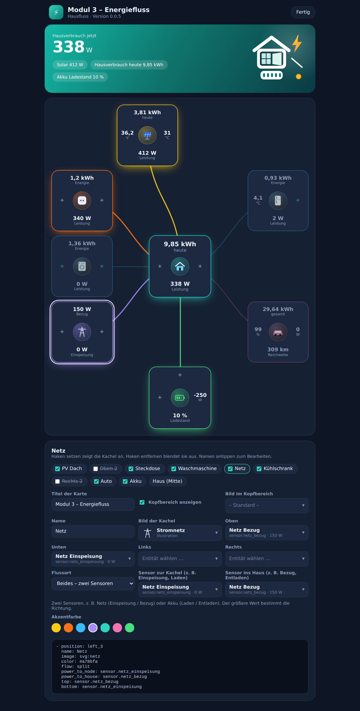
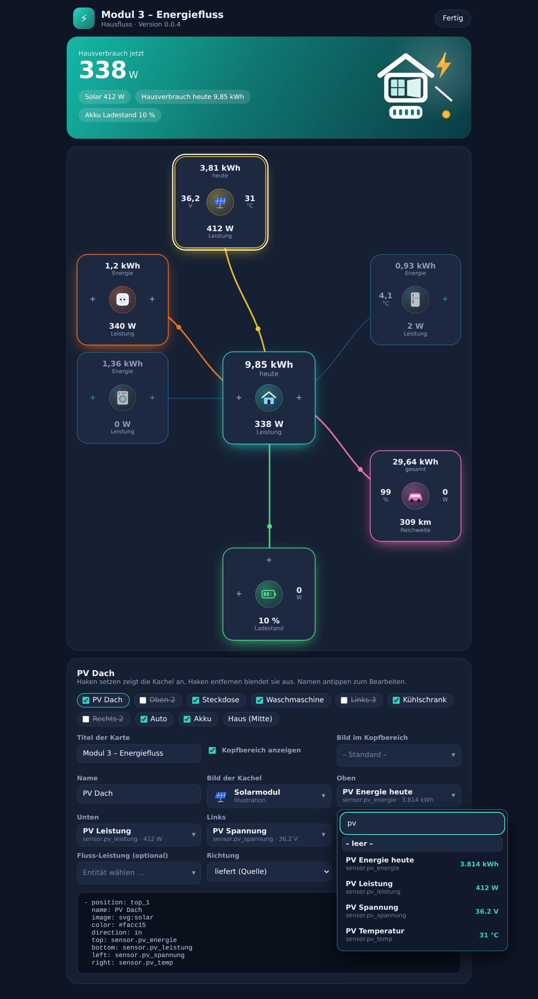
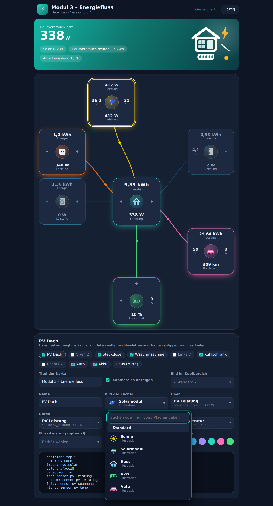

# Hausfluss – Modul 3 Energiefluss (v0.0.5)

Lovelace-Karte für Home Assistant: ein Haus-Knoten in der Mitte, bis zu 9 Kacheln drumherum.
Jede Kachel hat ein Bild in der Mitte und je eine Entität oben, unten, links und rechts.

## Vorschau


| Kacheln abgewählt | Mobil |
|---|---|
|  |  |

Die Bilder zeigen die Vorschau mit Beispieldaten.

## Seitenleiste (neu in 0.0.2)
Mit der Integration entsteht automatisch eine Seite **Energiefluss** links in der Seitenleiste.



- Die Karte läuft dort im Vollbild, mit Kopfbereich („Hausverbrauch jetzt“, Solar, Hausverbrauch heute und eigene Chips).
- Über **Anpassen** öffnet sich die Einrichtung der Kacheln: Haken setzen oder entfernen blendet eine Kachel ein oder aus, den Namen antippen zum Bearbeiten, oder die Kachel direkt auf der Karte antippen. Pro Kachel stellst du Name, Bild, Farbe, Richtung und die Entitäten für oben, unten, links und rechts ein. Das Ändern ist Administratoren vorbehalten.
- **Entitäten:** Ein Antippen öffnet ein Auswahlmenü mit Suchfeld. Gesucht wird in Name und Entitäts-ID, der aktuelle Wert steht daneben.
- **Bilder:** Ebenfalls ein Auswahlmenü mit Suchfeld, mit mitgelieferten Illustrationen (Sonne, Solarmodul, Auto, Akku, Waschmaschine, …) und Emojis. Eigene Bilder trägst du im Suchfeld ein: `mdi:flash` oder einen Pfad wie `/local/hausfluss/solar.png`.
- **Flussart:** Pro Kachel legst du fest, wie Energie fließt. Danach zeigt der Editor genau die passenden Sensorfelder:
  - *Verbraucht*: Energie fließt vom Haus zur Kachel (ein Sensor, optional).
  - *Liefert*: Energie fließt von der Kachel ins Haus, z. B. Solar (ein Sensor, optional).
  - *Beides – ein Sensor mit Vorzeichen*: für Netz oder Akku. Positiv heißt „zur Kachel“, negativ „ins Haus“. Liefert dein Sensor es umgekehrt, setzt du „Vorzeichen umkehren“.
  - *Beides – zwei Sensoren*: z. B. Netzbezug und Einspeisung oder Laden und Entladen. Der größere Wert bestimmt die Richtung.
- **Kopfbereich:** Rechts steht ein Bild (Standard: Haus mit Blitz). Es lässt sich ändern oder mit „Kein Bild“ ausblenden.
- Gespeichert wird zentral, alle Benutzer sehen dieselbe Seite.
- Titel, Symbol und „nur für Administratoren“ stellst du unter *Einstellungen → Geräte & Dienste → Hausfluss → Konfigurieren* ein.
- Die Karte steht zusätzlich weiter in jedem eigenen Dashboard zur Verfügung (siehe YAML-Beispiel). Dort öffnet der Karteneditor dieselbe Einrichtung.




| Entität suchen | Bild suchen |
|---|---|
|  |  |

## Installation (HACS, Kategorie Integration)
1. HACS → ⋮ → *Benutzerdefinierte Repositories* → Repository-URL eintragen, Kategorie **Integration**.
2. „Hausfluss“ installieren und Home Assistant neu starten.
3. Einstellungen → Geräte & Dienste → **Integration hinzufügen** → *Hausfluss*. Ein Klick genügt, die Seite **Energiefluss** erscheint danach in der Seitenleiste.
4. Seite öffnen → **Anpassen** → Kacheln und Entitäten wählen.

Manuell: den Ordner `custom_components/hausfluss` nach `config/custom_components/` kopieren.
Beim Veröffentlichen auf GitHub ein Release mit dem Tag `v0.0.5` anlegen und `DEIN-NAME` in der `manifest.json` ersetzen.

## YAML-Beispiel
```yaml
type: custom:hausfluss-card
title: Modul 3 – Energiefluss
show_hero: true        # false blendet den Kopfbereich aus
hero_image: svg:hero   # Bild rechts im Kopfbereich, none = kein Bild
hub:
  name: Haus
  image: 🏠
  top: sensor.haus_energie_heute   # Chip „Hausverbrauch heute“
  bottom: sensor.haus_leistung     # große Zahl im Kopfbereich
  chips: [sensor.akku_ladestand]   # weitere Chips (optional)
nodes:
  - position: top_1        # top_1, top_2, left_1-3, right_1-3, bottom
    enabled: true          # false blendet die Kachel aus
    name: PV Dach
    image: svg:solar                    # Illustration, Emoji, mdi:icon oder Pfad wie /local/hausfluss/solar.png
    color: "#facc15"
    flow: supply           # consume, supply, both oder split
    top: sensor.pv_energie_heute
    bottom: sensor.pv_leistung
    left: sensor.pv_spannung
    right: sensor.pv_temperatur
    power: sensor.pv_leistung   # optional, steuert die Fluss-Animation
  - position: left_3
    name: Netz
    flow: split            # zwei Sensoren
    power_to_node: sensor.netz_einspeisung
    power_to_house: sensor.netz_bezug
  - position: bottom
    name: Akku
    flow: both             # ein Sensor mit Vorzeichen
    power: sensor.akku_leistung
    invert: false          # true, wenn positiv = Entladen
```
Tippen auf einen Wert öffnet den Verlauf der Entität.

## Von 0.0.4 aktualisieren
Das alte Feld `direction` (`in` / `out`) funktioniert weiter. Es entspricht `flow: supply` und `flow: consume`.
